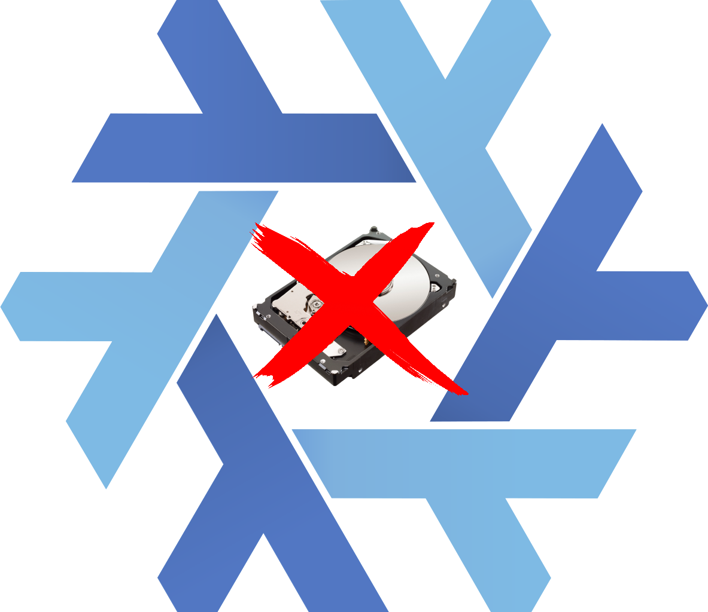

# NixOS Disk Destroyer

## Overview

A NixOS netbootable image for secure disk erasure, with a modern text interface (TUI).

## Interface

The TUI (`destroyer/`, Python + [Textual](https://textual.textualize.io/)) starts automatically on tty1:

1. **Disks** - table with path, type (NVMe/SSD/HDD/USB), model, serial, size, hardware-erase support and
   mount state. `Space` selects, `A` selects all, `R` rescans, `Enter` continues. Mounted disks cannot be selected.
2. **Method** - choose the erase method; the right panel shows what will happen to each selected disk.
3. **Confirm** - type `CANCELLA` to start. Optional power-off when everything succeeded.
4. **Progress** - one row per disk, all disks in parallel, with real percentage, MB/s, elapsed and
   remaining time, plus a live log. At the end: power off / reboot / new erase.

Keyboard only (Linux console). `start.sh` maps the 16 console colours to a dark theme and uses a large
Terminus font. If the TUI cannot start, the original `disk-format.sh` script runs instead.
Other consoles (Alt+F2...) are free for maintenance; type `destroyer` to reopen the TUI.

## Erase methods

| Method | What it does |
|---|---|
| **Automatic** (recommended) | Hardware erase when the disk supports it (NVMe sanitize crypto/block, NVMe format with secure erase, ATA (Enhanced) Secure Erase), otherwise 1 random pass (NIST 800-88 Clear/Purge) |
| Hardware only | NVMe sanitize/format or ATA Secure Erase; fails on disks without support or ATA "frozen" |
| 1 random pass | Overwrites the whole disk with random data |
| 1 zero pass + verify | Zeros, then reads back 2048 random blocks |
| 4 passes | 3 random + zeros (like `shred -n 3 -z`), with verification |
| DoD 5220.22-M | 3 passes: zeros, ones (0xFF), random |
| Quick | Wipes signatures and partition table (+ TRIM on SSD); data stays recoverable |

Every method ends with an empty GPT partition table. Overwrites are written directly by the program
(16 MB blocks, fsync every GB), so progress and speed are real and reaching the end of the disk is not
an error. NVMe sanitize progress is read from the drive (`sanitize-log`); ATA Secure Erase progress uses
the time estimate reported by the drive. If ATA Secure Erase fails, the temporary ATA password is removed
so the disk is not left locked.

## Build

```bash
nix-build '<nixpkgs/nixos/release.nix>' \
  -A netboot.x86_64-linux \
  --arg configuration ./configuration.nix \
  -I nixpkgs=channel:nixos-26.05
```

Without Nix installed, with Docker:

```bash
docker run --rm -v "$PWD":/src:ro -v "$PWD/out":/out -v dd-nix:/nix -w /src nixos/nix sh -c \
  "nix-build '<nixpkgs/nixos/release.nix>' -A netboot.x86_64-linux --arg configuration ./configuration.nix \
   -I nixpkgs=channel:nixos-26.05 -o /tmp/r && cp -L /tmp/r/* /out/"
```

The output contains `bzImage`, `initrd` and `netboot.ipxe` (with the `init=` path to use in the iPXE menu).

## Files

- `configuration.nix` - NixOS netboot configuration
- `destroyer/app.py` - TUI, `destroyer/app.tcss` - style, `destroyer/start.sh` - console setup and launch
- `destroyer/disks.py` - disk detection and hardware-erase capabilities (`lsblk`, `nvme id-ctrl`, `hdparm -I`)
- `destroyer/wipe.py` - erase methods with real progress
- `disk-format.sh` - original interactive script (fallback)

## Safety Warning

⚠️ **CAUTION**: This tool permanently erases disks. Use with extreme care.

## Contributing

Contributions welcome. Please open issues or submit pull requests.
